

# MinIONQC / ONTRunQC scientific comparison gallery

[Scientific comparison](../../minionqc-comparison.md) · [Documentation index](../../README.md) · [Reference commands](../../../tests/reference/README.md)

## How to read the figures

| Panel | Content | Interpretation |
| --- | --- | --- |
| A | Original MinIONQC | Actual pinned R output, not a native reconstruction. |
| B | Actual ONTRunQC | Canonical native figures; related All/Q panels may be stacked. |
| C | Numerical diagnostic | Units, populations and differences identified in the caption; first panel/group unless stated. |

Each card uses identical source bytes and Q cutoff. File-scoped validation matches R's grouping; source labels are not instrument run IDs. Different histogram grids are not treated as commensurable residuals. Functional coverage, numerical layer agreement and visual equivalence are separate claims.

**Strict GAM parity remains Partial:** the original-R comparison retains 1,542 fit/uncertainty discrepancies. These images do not replace that evidence.

**Plot mode:** `--minionqc-plot-bins`. Histogram/Bin2D geometry and counts use the original statistical layers; true channel counts intentionally correct the upstream count defect.

**Temporal mode:** `--minionqc-time-series`. Integer-hour counts include zero lengths and zero-filled gaps. Large cumulative curves are bounded full-data polylines; original-R tied-row ordering and simplification errors are reported separately. C temporal residuals are bounded samples; maxima evaluate every original timestamp/one-sided limit.

## Browse by analysis

- [Single MinION flowcell](#single-minion-flowcell)
- [Device and legacy checks](#device-and-legacy-checks)
- [Pooled and per-source comparisons](#pooled-and-per-source-comparisons)
- [Reproduction and provenance](#reproduction-and-provenance)

## Single MinION flowcell

Single-source distributions, temporal views, channel summaries and physical/read-level plots.

### length_histogram · minion · source_001

Original R vs explicit --minionqc-plot-bins, All summary population; selected facet separately validated. Log10 length before StatBin; Q includes zero lengths. Matched-bin residuals; see exact edge/count checks. Exact count L1=0; max boundary error=0.0.

Q cutoff: 7; input SHA-256 prefixes: 6b9a356c4aa99b65. Axes, units and populations follow the A/B labels and C caption.

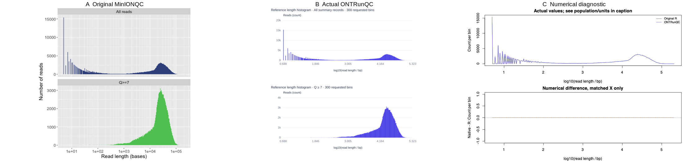

### q_histogram · minion · source_001

Original R vs explicit --minionqc-plot-bins, All summary population; selected facet separately validated. Log10 length before StatBin; Q includes zero lengths. Matched-bin residuals; see exact edge/count checks. Exact count L1=0; max boundary error=0.0.

Q cutoff: 7; input SHA-256 prefixes: 6b9a356c4aa99b65. Axes, units and populations follow the A/B labels and C caption.

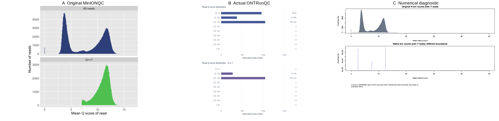

### flowcell_overview · minion · source_001

C compares complete finite R panel counts against native positive-length counts/channel. R overview grid includes every finite XY row; native counts/raster conservation separately tested. A/B layouts are exact R9.5.

Q cutoff: 7; input SHA-256 prefixes: 6b9a356c4aa99b65. Axes, units and populations follow the A/B labels and C caption.

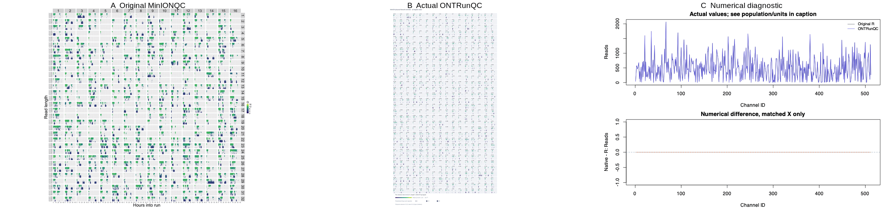

### yield_over_time · minion · source_001

EVERY original R timestamp and actual polyline one-sided limit evaluated. C shows post-tie residual samples only; full maximum envelope error 828561.3218617439 bp, original polyline error 828561.3218617439 bp, display bound 861327 bp. Tied internal order is a separately reported difference, not point-for-point parity.

Q cutoff: 7; input SHA-256 prefixes: 6b9a356c4aa99b65. Axes, units and populations follow the A/B labels and C caption.

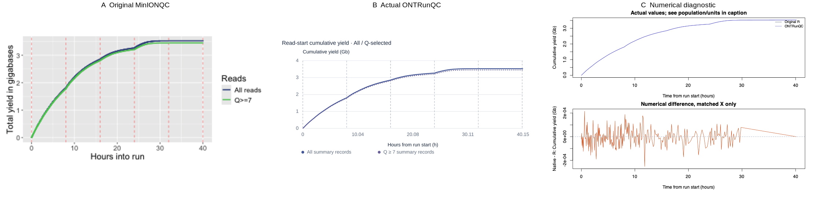

### yield_by_length · minion · source_001

R cropped per-read cumulative path; ONTRunQC exact inclusive minimum-length queries. Ties, crop and bounded display are distinct.

Q cutoff: 7; input SHA-256 prefixes: 6b9a356c4aa99b65. Axes, units and populations follow the A/B labels and C caption.

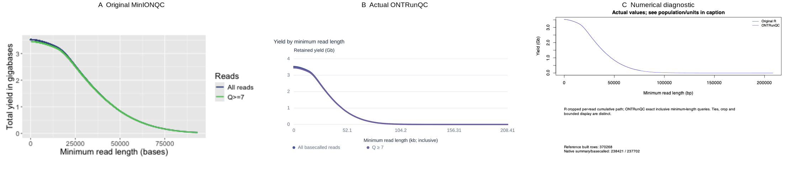

### length_by_hour · minion · source_001

Actual original-R fitted layer vs native Rust curve; original strict GAM failures remain failures in the separate differential suite.

Q cutoff: 7; input SHA-256 prefixes: 6b9a356c4aa99b65. Axes, units and populations follow the A/B labels and C caption.

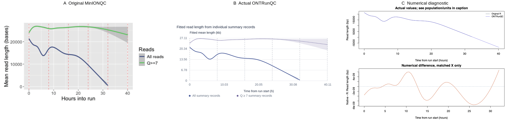

### q_by_hour · minion · source_001

Actual original-R fitted layer vs native Rust curve; original strict GAM failures remain failures in the separate differential suite.

Q cutoff: 7; input SHA-256 prefixes: 6b9a356c4aa99b65. Axes, units and populations follow the A/B labels and C caption.

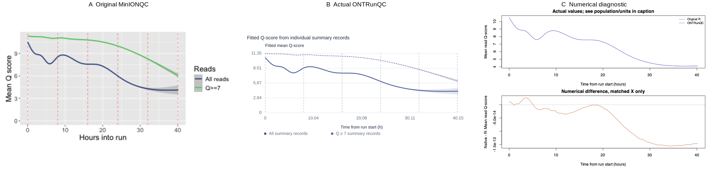

### reads_per_hour · minion · source_001

Explicit reference time mode: exact All summary counts per integer hour, including zero lengths and zero-filled gaps. Q-selected separately checked.

Q cutoff: 7; input SHA-256 prefixes: 6b9a356c4aa99b65. Axes, units and populations follow the A/B labels and C caption.

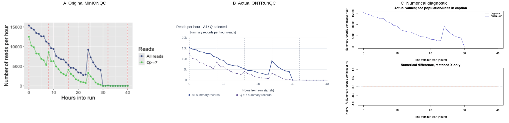

### length_vs_q · minion · source_001

C: complete 64-column log-length marginal from ALL finite R scatter coordinates versus coarsened native full-count pixels (or exact points). This is a diagnostic aggregation, not an original R histogram or independent point-by-point rendering.

Q cutoff: 7; input SHA-256 prefixes: 6b9a356c4aa99b65. Axes, units and populations follow the A/B labels and C caption.

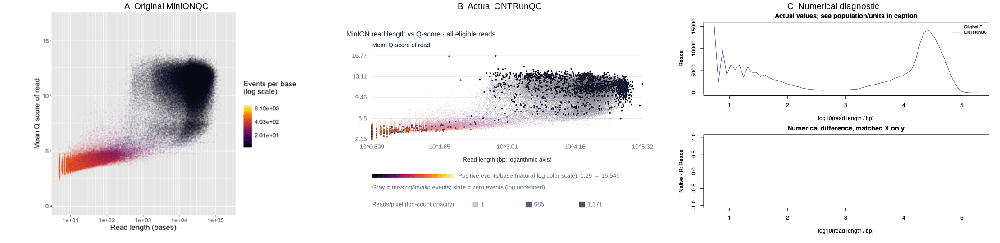

### channel_summary · minion · source_001

Explicit compatible binning on TRUE channel counts; original R uses n(n+1)/2. This intentional upstream-defect correction changes values AND bin limits; no false zero residual. Other three channel families validated separately.

Q cutoff: 7; input SHA-256 prefixes: 6b9a356c4aa99b65. Axes, units and populations follow the A/B labels and C caption.

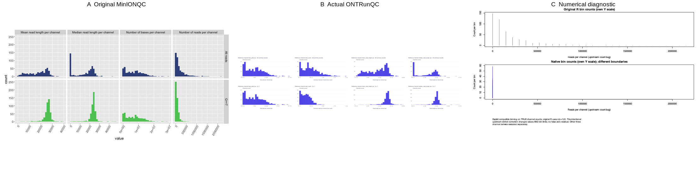

### gb_per_channel_overview · minion · source_001

C compares exact yield/channel; source spatial cells and panel/population totals retained. A/B share verified mapping, different missing-cell styling and palette.

Q cutoff: 7; input SHA-256 prefixes: 6b9a356c4aa99b65. Axes, units and populations follow the A/B labels and C caption.

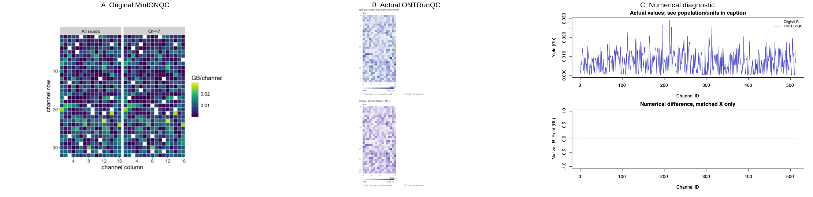

## Device and legacy checks

PromethION, short-run, 1D2 and direct-RNA examples exercise distinct schemas and plot populations.

### length_histogram · promethion · source_001

Original R vs explicit --minionqc-plot-bins, All summary population; selected facet separately validated. Log10 length before StatBin; Q includes zero lengths. Matched-bin residuals; see exact edge/count checks. Exact count L1=0; max boundary error=0.0.

Q cutoff: 7; input SHA-256 prefixes: dd508d9dc645519e. Axes, units and populations follow the A/B labels and C caption.

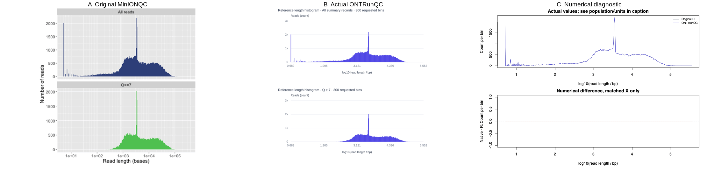

### q_histogram · promethion · source_001

Original R vs explicit --minionqc-plot-bins, All summary population; selected facet separately validated. Log10 length before StatBin; Q includes zero lengths. Matched-bin residuals; see exact edge/count checks. Exact count L1=0; max boundary error=0.0.

Q cutoff: 7; input SHA-256 prefixes: dd508d9dc645519e. Axes, units and populations follow the A/B labels and C caption.

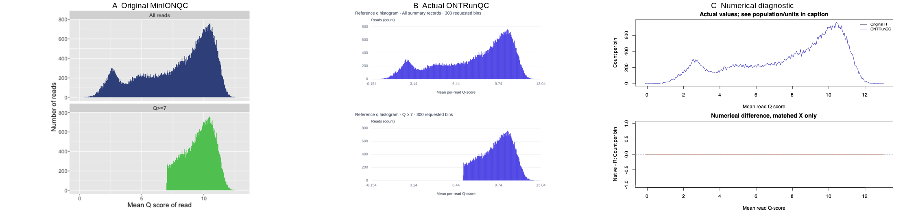

### yield_over_time · promethion · source_001

EVERY original R timestamp and actual polyline one-sided limit evaluated. C shows post-tie residual samples only; full maximum envelope error 115323.453764759 bp, original polyline error 115323.453764759 bp, display bound 152148 bp. Tied internal order is a separately reported difference, not point-for-point parity.

Q cutoff: 7; input SHA-256 prefixes: dd508d9dc645519e. Axes, units and populations follow the A/B labels and C caption.

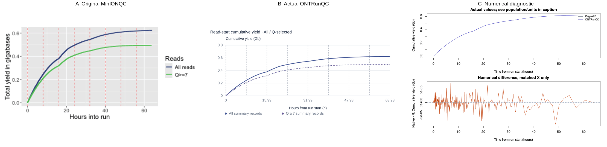

### reads_per_hour · promethion · source_001

Explicit reference time mode: exact All summary counts per integer hour, including zero lengths and zero-filled gaps. Q-selected separately checked.

Q cutoff: 7; input SHA-256 prefixes: dd508d9dc645519e. Axes, units and populations follow the A/B labels and C caption.

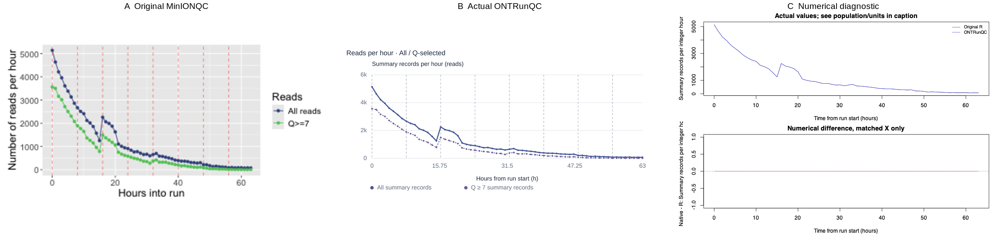

### length_vs_q · promethion · source_001

Original R vs explicit --minionqc-plot-bins: corresponding occupied cells ordered by transformed X/Y; cell counts and all six boundaries independently compared. C uses cell index, not a reconstructed 1D distribution. Exact count L1=0; max boundary error=0.0.

Q cutoff: 7; input SHA-256 prefixes: dd508d9dc645519e. Axes, units and populations follow the A/B labels and C caption.

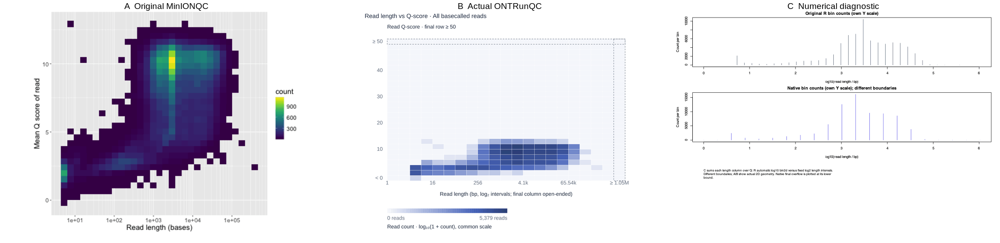

### channel_summary · promethion · source_001

Explicit compatible binning on TRUE channel counts; original R uses n(n+1)/2. This intentional upstream-defect correction changes values AND bin limits; no false zero residual. Other three channel families validated separately.

Q cutoff: 7; input SHA-256 prefixes: dd508d9dc645519e. Axes, units and populations follow the A/B labels and C caption.

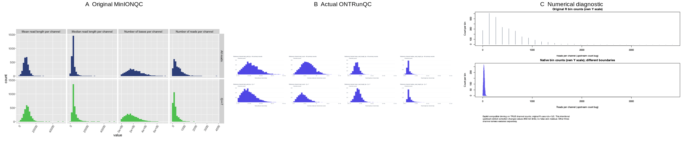

### yield_over_time · short · source_001

EVERY original R timestamp and actual polyline one-sided limit evaluated. C shows post-tie residual samples only; full maximum envelope error 0 bp, original polyline error 28536 bp, display bound 0 bp. Tied internal order is a separately reported difference, not point-for-point parity.

Q cutoff: 8; input SHA-256 prefixes: 60a070e325b0c2e3. Axes, units and populations follow the A/B labels and C caption.

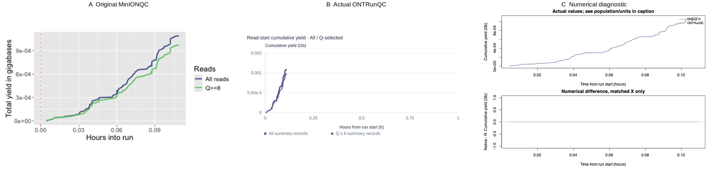

### reads_per_hour · short · source_001

Explicit reference time mode: exact All summary counts per integer hour, including zero lengths and zero-filled gaps. Q-selected separately checked.

Q cutoff: 8; input SHA-256 prefixes: 60a070e325b0c2e3. Axes, units and populations follow the A/B labels and C caption.

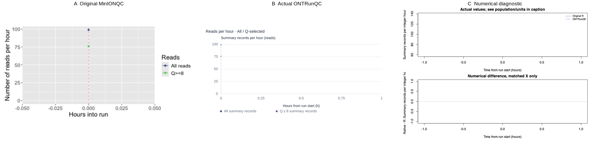

### yield_over_time · 1d2 · source_001

EVERY original R timestamp and actual polyline one-sided limit evaluated. C shows post-tie residual samples only; full maximum envelope error 159758.3499878049 bp, original polyline error 159758.3499878049 bp, display bound 227112 bp. Tied internal order is a separately reported difference, not point-for-point parity.

Q cutoff: 8; input SHA-256 prefixes: c71245ad265ed1a1. Axes, units and populations follow the A/B labels and C caption.

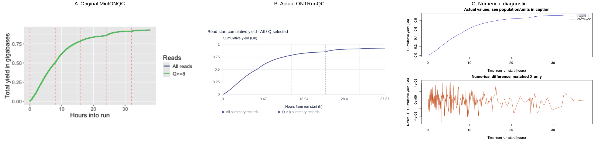

### reads_per_hour · 1d2 · source_001

Explicit reference time mode: exact All summary counts per integer hour, including zero lengths and zero-filled gaps. Q-selected separately checked.

Q cutoff: 8; input SHA-256 prefixes: c71245ad265ed1a1. Axes, units and populations follow the A/B labels and C caption.

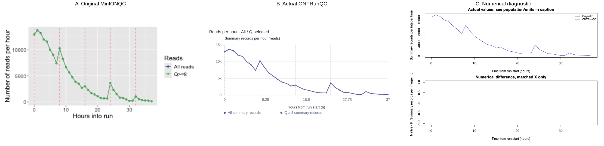

### length_vs_q · 1d2 · source_001

C: complete 64-column log-length marginal from ALL finite R scatter coordinates versus coarsened native full-count pixels (or exact points). This is a diagnostic aggregation, not an original R histogram or independent point-by-point rendering.

Q cutoff: 8; input SHA-256 prefixes: c71245ad265ed1a1. Axes, units and populations follow the A/B labels and C caption.

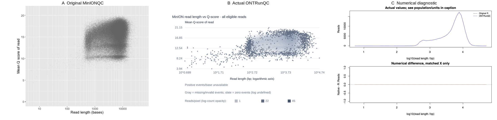

### q_histogram · rna · source_001

Original R vs explicit --minionqc-plot-bins, All summary population; selected facet separately validated. Log10 length before StatBin; Q includes zero lengths. Matched-bin residuals; see exact edge/count checks. Exact count L1=0; max boundary error=0.0.

Q cutoff: 7; input SHA-256 prefixes: 1d1860dabc15ed69. Axes, units and populations follow the A/B labels and C caption.

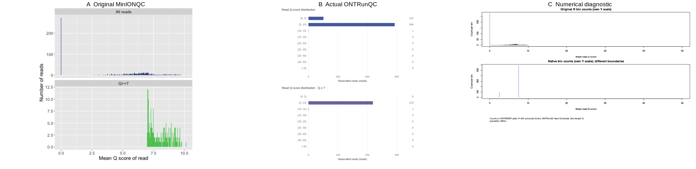

### yield_over_time · rna · source_001

EVERY original R timestamp and actual polyline one-sided limit evaluated. C shows post-tie residual samples only; full maximum envelope error 0 bp, original polyline error 76 bp, display bound 0 bp. Tied internal order is a separately reported difference, not point-for-point parity.

Q cutoff: 7; input SHA-256 prefixes: 1d1860dabc15ed69. Axes, units and populations follow the A/B labels and C caption.

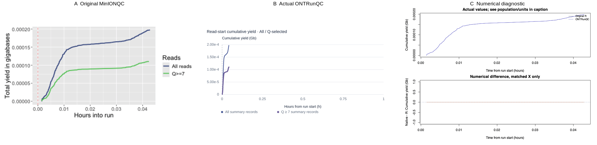

### reads_per_hour · rna · source_001

Explicit reference time mode: exact All summary counts per integer hour, including zero lengths and zero-filled gaps. Q-selected separately checked.

Q cutoff: 7; input SHA-256 prefixes: 1d1860dabc15ed69. Axes, units and populations follow the A/B labels and C caption.

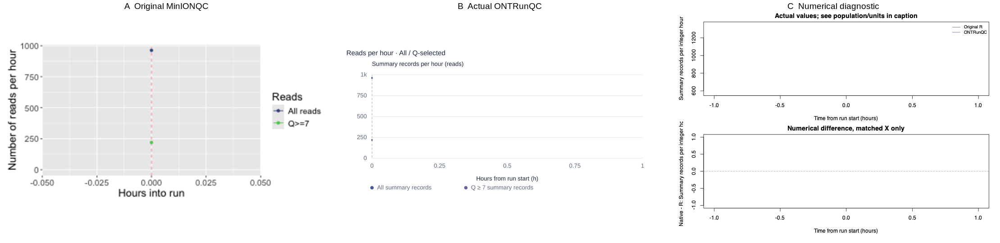

## Pooled and per-source comparisons

Pooled distributions and per-source comparisons are labeled separately; pooled medians/N50 are not averages.

### yield_over_time · combined · source_001

EVERY original R timestamp and actual polyline one-sided limit evaluated. C shows post-tie residual samples only; full maximum envelope error 828561.3218617439 bp, original polyline error 828561.3218617439 bp, display bound 861327 bp. Tied internal order is a separately reported difference, not point-for-point parity.

Q cutoff: 7; input SHA-256 prefixes: 6b9a356c4aa99b65, 1c77d6b888e49641. Axes, units and populations follow the A/B labels and C caption.

### reads_per_hour · combined · source_001

Explicit reference time mode: exact All summary counts per integer hour, including zero lengths and zero-filled gaps. Q-selected separately checked.

Q cutoff: 7; input SHA-256 prefixes: 6b9a356c4aa99b65, 1c77d6b888e49641. Axes, units and populations follow the A/B labels and C caption.

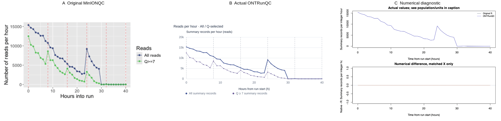

### yield_over_time · combined · source_002

EVERY original R timestamp and actual polyline one-sided limit evaluated. C shows post-tie residual samples only; full maximum envelope error 815020.1101899147 bp, original polyline error 815020.1101899147 bp, display bound 897293 bp. Tied internal order is a separately reported difference, not point-for-point parity.

Q cutoff: 7; input SHA-256 prefixes: 6b9a356c4aa99b65, 1c77d6b888e49641. Axes, units and populations follow the A/B labels and C caption.

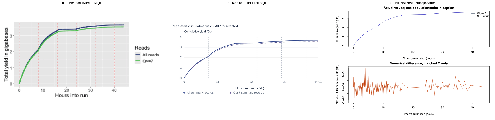

### reads_per_hour · combined · source_002

Explicit reference time mode: exact All summary counts per integer hour, including zero lengths and zero-filled gaps. Q-selected separately checked.

Q cutoff: 7; input SHA-256 prefixes: 6b9a356c4aa99b65, 1c77d6b888e49641. Axes, units and populations follow the A/B labels and C caption.

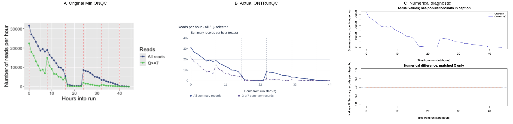

### combined_length_histogram · combined · combined

Original R vs explicit --minionqc-plot-bins, All summary population; selected facet separately validated. Log10 length before StatBin; Q includes zero lengths. Matched-bin residuals; see exact edge/count checks. Exact count L1=0; max boundary error=0.0.

Q cutoff: 7; input SHA-256 prefixes: 6b9a356c4aa99b65, 1c77d6b888e49641. Axes, units and populations follow the A/B labels and C caption.

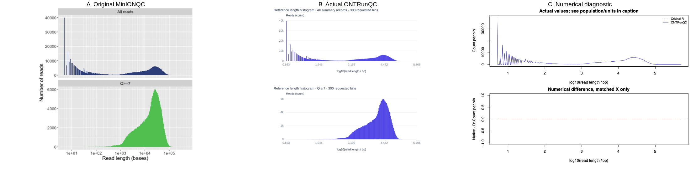

### combined_q_histogram · combined · combined

Original R vs explicit --minionqc-plot-bins, All summary population; selected facet separately validated. Log10 length before StatBin; Q includes zero lengths. Matched-bin residuals; see exact edge/count checks. Exact count L1=0; max boundary error=0.0.

Q cutoff: 7; input SHA-256 prefixes: 6b9a356c4aa99b65, 1c77d6b888e49641. Axes, units and populations follow the A/B labels and C caption.

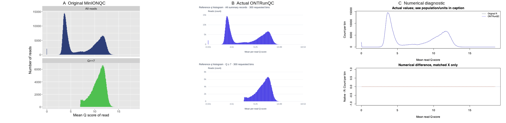

### combined_yield_by_length · combined · combined

R cropped per-read cumulative path; ONTRunQC exact inclusive minimum-length queries. Ties, crop and bounded display are distinct.

Q cutoff: 7; input SHA-256 prefixes: 6b9a356c4aa99b65, 1c77d6b888e49641. Axes, units and populations follow the A/B labels and C caption.

### length_distributions · combined · combined

Actual ggplot StatDensity vs opt-in R-grid Rust estimator; log-length KDE is computed AFTER log10 transform.

Q cutoff: 7; input SHA-256 prefixes: 6b9a356c4aa99b65, 1c77d6b888e49641. Axes, units and populations follow the A/B labels and C caption.

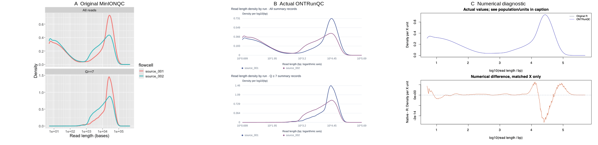

### q_distributions · combined · combined

Actual ggplot StatDensity vs opt-in R-grid Rust estimator; log-length KDE is computed AFTER log10 transform.

Q cutoff: 7; input SHA-256 prefixes: 6b9a356c4aa99b65, 1c77d6b888e49641. Axes, units and populations follow the A/B labels and C caption.

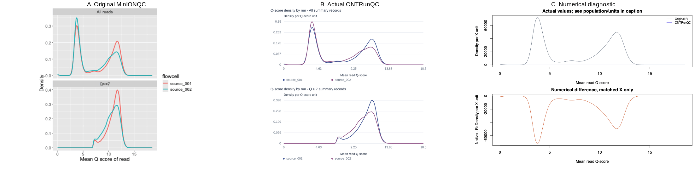

### yield_over_time · combined · combined

EVERY original R timestamp and actual polyline one-sided limit evaluated. C shows post-tie residual samples only; full maximum envelope error 828561.3218617439 bp, original polyline error 828561.3218617439 bp, display bound 861327 bp. Tied internal order is a separately reported difference, not point-for-point parity.

Q cutoff: 7; input SHA-256 prefixes: 6b9a356c4aa99b65, 1c77d6b888e49641. Axes, units and populations follow the A/B labels and C caption.

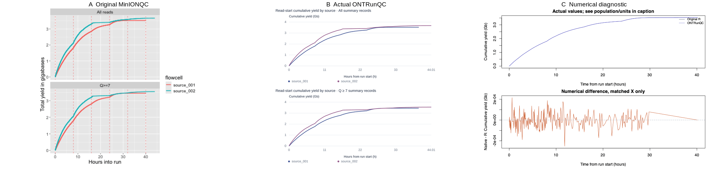

### yield_by_length · combined · combined

R cropped per-read cumulative path; ONTRunQC exact inclusive minimum-length queries. Ties, crop and bounded display are distinct.

Q cutoff: 7; input SHA-256 prefixes: 6b9a356c4aa99b65, 1c77d6b888e49641. Axes, units and populations follow the A/B labels and C caption.

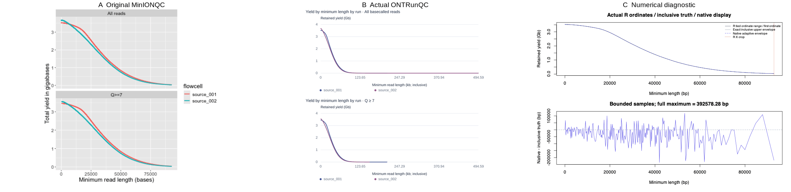

### length_by_hour · combined · combined

Actual original-R fitted layer vs native Rust curve; original strict GAM failures remain failures in the separate differential suite.

Q cutoff: 7; input SHA-256 prefixes: 6b9a356c4aa99b65, 1c77d6b888e49641. Axes, units and populations follow the A/B labels and C caption.

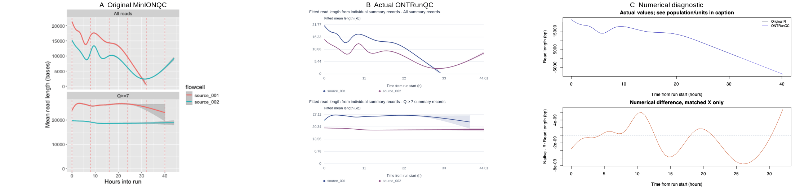

### q_by_hour · combined · combined

Actual original-R fitted layer vs native Rust curve; original strict GAM failures remain failures in the separate differential suite.

Q cutoff: 7; input SHA-256 prefixes: 6b9a356c4aa99b65, 1c77d6b888e49641. Axes, units and populations follow the A/B labels and C caption.

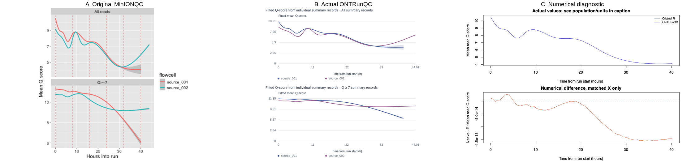

## Reproduction and provenance

- Source commit: `54485d586038d8ee36f168dd94f31c423f52f581`.
- Reference environment: R 4.4.1, ggplot2 3.5.1, mgcv 1.9-1.
- Full input hashes, numerical checks, audit-script hashes and measurements: [measurements.json](measurements.json).
- Generate figures with `python3 tests/reference/plot_audit.py --help`; prerequisites and commands are in the [reference guide](../../../tests/reference/README.md#formula-and-visual-layer-audit-18).
- Full captures/reports remain outside Git in `benchmark-results/plot-audit/`.

Original R smallfigures TRUE, PNG 60 DPI for audit readability; native canonical figures 300 DPI; gallery resized and palette-reduced to 256 colours only for documentation. Original files remain unchanged.

This index is generated from recorded measurements; restructuring it does not rerun R or alter reference curves, images or discrepancy classifications.

Public fixture figures derive from Rob Lanfear's MinIONQC (MIT). See the [upstream license](https://github.com/roblanf/minion_qc/blob/54485d586038d8ee36f168dd94f31c423f52f581/LICENSE).
